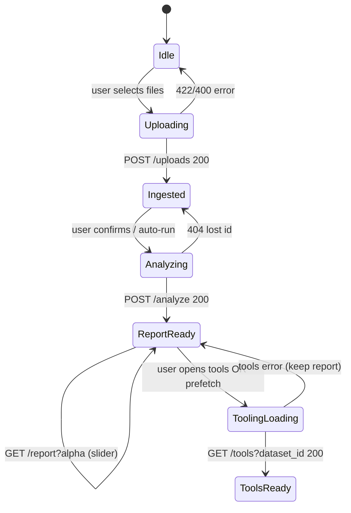

# Frontend guide — real uploads, judge demo, and LLM tooling

This doc is for anyone building the UI. The **primary path is not `/demo`**: judges should see **their own CSVs uploaded**, a **dataset built on the server**, engines run **once**, rankings from **that** restaurant, and **tool recommendations fired only when appropriate** (slow LLM — never block upload/analyze).

**Swagger:** `http://<API_HOST>:8080/docs` while uvicorn is running.

**Base URL:** default `http://127.0.0.1:8080` (or your deployed host). **CORS** allows `http://localhost:3001` only — point the dev frontend at that origin or proxy API calls.

**Env (server):** `OPENROUTER_API_KEY` in `AISB/.env` (required for chat and tools). Optional: `CHAT_STREAM_MODEL` (grill chat, default `openai/gpt-4o-mini`), `TOOL_REC_MODEL` (tool research, default `openai/gpt-4o-mini`).

---

## What the backend does in five stages

Understand **when work happens** so the UI does not call endpoints too early or twice.

| Stage | HTTP call | Server work | Typical duration | Cached? |
|-------|-----------|-------------|------------------|---------|
| **1. Ingest** | `POST /uploads` | Read files → map columns → **`build_dataset`** → store `Dataset` in memory | ~1–10 s (file count/size) | `dataset_id` until server restart |
| **2. Analyze** | `POST /analyze/{dataset_id}` | Run cost + time **engines once** → store `Analysis` | ~2–15 s | Until server restart |
| **3. Re-rank** | `GET /report/{dataset_id}?alpha=` | **`build_report` only** (blend $ vs time) — **no** re-ingest, **no** re-run detectors | &lt; 1 s | Same `Analysis` |
| **4. Tooling** | `GET /tools?dataset_id=&alpha=` | OpenRouter LLM from **that** report’s `top_problems` — **30–90+ s** (longer with 3 problems) | Long | Not cached |
| **5. Grill chat** | `POST /chat/sessions` + `POST /chat/sessions/{id}/messages` (SSE) | OpenRouter chat that interrogates the owner about **one** problem; swaps the problem when the owner changes topic and re-runs the tools pipeline in the background | Reply streams in ~1–3 s; tools **30–90+ s** in background | In memory per `session_id` until server restart |

**Rules for frontend**

1. **Never** call analyze before a successful upload returns `dataset_id`.
2. **Never** call `GET /report` before analyze (you get **409**).
3. **Do not** call `POST /analyze` again when the user moves the **alpha** slider — use **`GET /report/{dataset_id}?alpha=`**.
4. **Do not** call tooling in parallel with upload or analyze — show the report first, then start tooling in a **separate** step (button or lazy panel).
5. **Do not** chain tooling inside the upload/analyze loading spinner (judges will think the app froze).



---

## Judge demo script (real files, not `/demo`)

Use this flow on stage so judges see **upload → ingest feedback → analyze → top 3 on their data**.

### Before the demo

1. **Backend running** (do not restart mid-demo — in-memory IDs are wiped):

   ```bash
   cd AISB
   source .venv/bin/activate
   uvicorn backend.api:app --host 0.0.0.0 --port 8080
   ```

2. **`OPENROUTER_API_KEY`** in `AISB/.env` if you will show tooling (stage 4). Restart uvicorn after changing `.env`.

3. **Sample CSVs** (realistic multi-file restaurant pack):

   ```bash
   python -m backend.synthetic.generate --out backend/synthetic/data
   ```

   Upload **all** generated `.csv` files from `backend/synthetic/data/` in **one** `POST /uploads`, or use an equivalent export from a real POS/back-office. More domains → richer `top_problems` and fewer `not_assessed` rows.

4. **Profile JSON** so the header shows a real name (optional but good for judges):

   ```json
   { "name": "Judge Demo — Mario's Trattoria", "sqft": 3200, "seats": 90 }
   ```

### On stage (recommended narrative)

| Step | UI | API | What to say |
|------|-----|-----|-------------|
| 1 | File picker + “Upload” | `POST /uploads` | “We map messy exports to a canonical dataset.” |
| 2 | Ingest summary screen | Response: `domains`, `files`, `data_quality` | “These are the data types we recognized.” |
| 3 | “Run analysis” (spinner) | `POST /analyze/{dataset_id}?alpha=0.7` | “Engines estimate $ and time pain per category.” |
| 4 | Results dashboard | Use analyze response **or** `GET /report` | “Top 3 problems for **this** restaurant.” |
| 5 | Alpha slider | `GET /report/{dataset_id}?alpha=` only | “Owner can weigh money vs time.” |
| 6 | Optional: “Find AI tools” | `GET /tools?dataset_id={id}&alpha=` (slow) | “Research runs **after** we know the problems — for **this** upload.” |

**Do not** open the demo with `GET /demo` if the story is “we ingest your files.” Reserve `/demo` for dev smoke tests or a “skip upload” escape hatch.

### Prove it’s not canned data

Point judges at fields that come from **their** upload:

- `report.restaurant.name` matches `profile.name` you sent.
- `report.files` lists their filenames and domain mappings.
- `report.data_quality` and `domains` match the ingest screen.
- `report.skipped` / `not_assessed` show honest limits when files are missing.

---

## Stage 1 — `POST /uploads` (build dataset **here**)

**This is the only step that runs ingest / `build_dataset`.** Analyze does not re-read raw files from disk; it uses the in-memory `Dataset` stored under `dataset_id`.

**Request:** `multipart/form-data`

| Field | Type | Required |
|-------|------|----------|
| `files` | file[] (repeat field name `files`) | yes |
| `profile` | string, JSON object | no |

Supported extensions: `.csv`, `.xlsx`, `.xls`, `.xlsm`.

**Example (browser):**

```ts
const form = new FormData();
for (const file of selectedFiles) {
  form.append("files", file); // same field name for every file
}
form.append(
  "profile",
  JSON.stringify({ name: restaurantName, sqft: 3000 })
);

const ingestRes = await fetch(`${API}/uploads`, { method: "POST", body: form });
const ingest = await ingestRes.json();
if (!ingestRes.ok) throw ingest;
const { dataset_id, domains, files, data_quality } = ingest;
// Persist dataset_id (sessionStorage) until server restart
```

**Success (200):**

```json
{
  "dataset_id": "a1b2c3d4e5f6",
  "domains": ["inventory", "sales", "timeclock"],
  "files": [/* mapping per uploaded file */],
  "data_quality": { "sales": { "...": "..." } }
}
```

**UI after ingest**

- Show `domains.length` and a per-file mapping from `files` (matched vs unmapped columns).
- If `domains` is small, warn that ranking may be thin (`not_assessed` on report).
- Store `dataset_id`; enable “Run analysis” only now.

**Errors**

| Code | Meaning |
|------|---------|
| 400 | Invalid `profile` JSON |
| 422 | No file matched a known schema — FastAPI `detail` is an object: `{ "error": "...", "files": [...] }` |

---

## Stage 2 — `POST /analyze/{dataset_id}` (engines — **once**)

```ts
const report = await fetch(
  `${API}/analyze/${dataset_id}?alpha=0.7`,
  { method: "POST" }
).then(async (r) => {
  if (!r.ok) throw new Error(JSON.stringify(await r.json()));
  return r.json();
});
```

- **First time** for this `dataset_id` you **must** POST analyze.
- Response is the full **report** (same shape as `/report` and `/demo`).
- Keep the report in client state; you do not need to POST analyze again for the same upload.

**Errors**

| Code | Action |
|------|--------|
| 404 | `dataset_id` unknown (server restarted or wrong id) → back to upload |
| 422 | Bad `alpha` query param |

---

## Stage 3 — `GET /report/{dataset_id}?alpha=` (slider — **fast**)

Same report object as `POST /analyze/{dataset_id}` and (without an upload) `GET /demo?alpha=`.

When the user changes money vs time weighting:

```ts
const report = await fetch(
  `${API}/report/${dataset_id}?alpha=${alpha}`
).then((r) => r.json());
```

| `alpha` | Meaning |
|---------|---------|
| `1.0` | Rank by money only |
| `0.0` | Rank by time only |
| `0.7` | Default blend |

**409** means analyze was never run — call `POST /analyze/{dataset_id}` once, then use GET report.

---

## Stage 4 — `GET /tools?dataset_id=` (slow — **after** report is visible)

### What the backend does

After **analyze** (or when using synthetic data), call tools with the **same** `dataset_id` as the report (`"demo"` for `GET /demo` smoke tests). The server:

1. Rebuilds the report at the requested `alpha` (same blending as `/report`).
2. Builds one LLM brief per entry in `top_problems` (usually **3**): `"{label}: {summary}"`.
3. Runs `get_tools` once for all of those briefs (web research + strict JSON structuring + normalisation).

| `dataset_id` | Requirement |
|--------------|-------------|
| Upload id | `POST /analyze/{dataset_id}` must have succeeded |
| `"demo"` | No upload — uses cached synthetic analysis |

**Query params**

| Param | Required | Notes |
|-------|----------|--------|
| `dataset_id` | yes | Upload id or `"demo"` |
| `alpha` | no | Same as report slider (default `0.7`) — re-ranks problems before picking briefs |

### Timing and UX

| Do | Don’t |
|----|--------|
| Start tooling **after** `top_problems` is on screen | Await tools inside upload/analyze |
| Dedicated panel: “Researching tools… 30–90s” (use **180s** timeout for 3 problems) | Block the whole app on one spinner |
| `AbortController` + retry on failure | Assume tools finished because analyze did |
| Let user read drivers/summary while tools load | Fire tools on every alpha tweak (only refetch if the user explicitly asks) |

Optional **prefetch:** when analyze completes, fire `GET /tools?dataset_id=…` in the background if the user enabled “Include AI recommendations,” but still render the report immediately from analyze.

**Call pattern:**

```ts
const params = new URLSearchParams({ dataset_id: datasetId, alpha: String(alpha) });
const controller = new AbortController();
const timeout = setTimeout(() => controller.abort(), 180_000);

const toolsRes = await fetch(`${API}/tools?${params}`, { signal: controller.signal });
clearTimeout(timeout);
const body = await toolsRes.json();
if (!toolsRes.ok) {
  throw new Error(typeof body.detail === "string" ? body.detail : JSON.stringify(body.detail));
}
const toolRecs = body as ToolRecs;
// toolRecs.recommendations.length === report.top_problems.length (when the API had confident problems)
```

**Response:** plain JSON (`ToolRecs`): `recommendations[]` — **one entry per `top_problem` brief**, each `{ problem, final_recommendation, tools: Tool[] }` with up to **4** tools (`platform_integrated` / `highest_roi`). The backend normalises model output so every tool field is always present (`"Not publicly available"` when unverified). See [Parsing LLM output](#parsing-llm-output-for-the-ui).

**Errors**

| Code | Meaning |
|------|---------|
| 404 | Unknown `dataset_id` |
| 409 | Upload exists but analyze never ran |
| 422 | No confident `top_problems` to research |
| 500 | OpenRouter / LLM failure — show `detail`, keep report on screen, offer retry |

---

## Stage 5 — Grill-me chat (`/chat/sessions`)

A chat where an AI interrogator drills the owner on **one problem at a time** until it is clearly understood. It does **not** need upload/analyze, but you can pass a `dataset_id` (or `"demo"`) so the questions are grounded in that restaurant's top problems.

How it behaves:

- Only **one problem is in focus**. When the owner switches topic, the backend **drops the old problem and its working context**, adopts the new one, and clears prior tool results (`tools.status` → `idle`) until enough context is collected again.
- **Tool research** (`get_tools` on `problem` + `known_facts`) starts only after **either** the extractor marks the problem **`understood: true`** **or** the owner has sent **4 messages** on the current problem (whichever comes first). Earlier turns are grill-only (no SSE `tools` event).
- The transcript is never wiped: a switch is recorded as a message with `role: "event"` and `type: "problem_changed"` so the UI can draw a divider.
- A problem only becomes `understood: true` after **≥ 3 owner answers** on it and `clarity ≥ 85`.
- Sessions live in server memory (lost on restart, like `dataset_id`).

### 1. Create a session

```ts
// Body is optional — omit it for a chat with no upload context (tools still work from conversation)
const createRes = await fetch(`${API}/chat/sessions`, {
  method: "POST",
  headers: { "Content-Type": "application/json" },
  body: JSON.stringify({ dataset_id: datasetId ?? null }), // omit entire body if always null
});
const created = await createRes.json();
if (!createRes.ok) {
  throw new Error(typeof created.detail === "string" ? created.detail : JSON.stringify(created.detail));
}
const session = created as ChatSession;
// session.messages[0] is the grilling opener (assistant) — render it
```

When `dataset_id` is set (upload id or `"demo"`), the server loads that restaurant’s analysed report and injects name + `top_problems` summaries into the grill context. **`dataset_id` rules match `/tools`** (404 unknown id, 409 if upload not analyzed yet).

### 2. Send a message (SSE stream)

`POST /chat/sessions/{id}/messages` with `{ "message": "…" }` (1–4000 chars). The response is `text/event-stream`. `EventSource` only supports GET, so read the stream with `fetch`:

```ts
async function sendMessage(sessionId: string, message: string, on: (e: ChatEvent) => void) {
  const res = await fetch(`${API}/chat/sessions/${sessionId}/messages`, {
    method: "POST",
    headers: { "Content-Type": "application/json" },
    body: JSON.stringify({ message }),
  });
  if (!res.ok) throw new Error((await res.json()).detail); // 404 / 409 / 422 / 500 arrive before streaming
  const reader = res.body!.getReader();
  const decoder = new TextDecoder();
  let buf = "";
  for (;;) {
    const { value, done } = await reader.read();
    if (done) break;
    buf += decoder.decode(value, { stream: true });
    let i;
    while ((i = buf.indexOf("\n\n")) >= 0) {
      const block = buf.slice(0, i);
      buf = buf.slice(i + 2);
      const event = /^event: (.*)$/m.exec(block)![1];
      const data = JSON.parse(/^data: (.*)$/m.exec(block)![1]);
      on({ event, data } as ChatEvent);
    }
  }
}
```

Events, in order:

| Event | When | Payload |
|-------|------|---------|
| `state` | Right after the message is analysed (before any text) | `problem`, `problem_version`, `understood`, `clarity` (0–100), `known_facts[]`, `open_questions[]`, `action` (`keep` \| `refine` \| `new_problem`), `previous_problem` |
| `tools` | Only when tool research was just (re)started | `status: "running"`, `problem` (the exact brief sent to the tools pipeline) |
| `token` | Many times | `delta` — append to the assistant bubble |
| `done` | End of stream | `state`, `tools` (status only, no result) |
| `error` | Analysis or stream failed | `message` — `done` may still follow |

Use `state` to update a "Current problem" header and a clarity meter immediately; when `action === "new_problem"`, show a "Switched problem" divider and clear the tools panel (it is now stale).

### 3. Poll for tool recommendations

Tools run **30–90+ s after** the stream ends, so poll `GET /chat/sessions/{id}` every 2–3 s while `tools.status === "running"`:

```ts
type ToolsState = {
  status: "idle" | "running" | "ready" | "error";
  problem: string | null; // brief these results were produced for
  result: ToolRecs | string | null; // parsed JSON from get_tools, or raw text if it wasn't JSON
  error: string | null;
  updated_at: number;
};
```

Only show `result` when `tools.problem` matches the current problem; a run for a replaced problem is discarded by the server.

### Other chat calls and errors

| Call | Notes |
|------|-------|
| `GET /chat/sessions/{id}` | Full session: `messages[]`, problem state, `tools` (with `result`) |
| `DELETE /chat/sessions/{id}` | End the session |

| Code | When |
|------|------|
| 404 | Unknown `session_id`; or unknown `dataset_id` on create |
| 409 | Previous message is still streaming — disable the input until `done`; or `dataset_id` upload not analyzed |
| 422 | Empty or too-long `message` (validation on `ChatMessageIn`) |
| 500 | Missing `OPENROUTER_API_KEY` or OpenRouter failure before the stream starts |

Mid-stream failures arrive as SSE `event: error` with `{ message }` (HTTP stays 200). Chat model: `CHAT_STREAM_MODEL` (see env vars at the top).

**When tool research starts** (SSE `tools`, then poll `GET /chat/sessions/{id}`): on the message where **`understood` flips to true** (needs **≥ 3** owner answers and **clarity ≥ 85**) **or** on the **4th** owner message on the current problem if still not understood. Switching problems resets the count and tool state; the grill runs again before the next tooling call. If the brief changes after tools already **ready** for an older brief, research runs again once the threshold is still met.

---

## Suggested client state (TypeScript)

```ts
type AppPhase =
  | "idle"
  | "uploading"      // POST /uploads
  | "ingested"       // have dataset_id, show ingest summary
  | "analyzing"      // POST /analyze
  | "report_ready"   // have report JSON
  | "tools_loading"  // GET /tools in flight
  | "tools_ready";

type Session = {
  datasetId: string | null;
  alpha: number;
  ingest: UploadResponse | null;
  report: Report | null;
  tools: ToolRecs | null;
  toolsError: string | null;
  chat: ChatSession | null; // Stage 5 (independent of the phases above)
};

type Tool = {
  tool_number: number; // 1-4 within a problem
  tool_name: string;
  tool_description: string;
  tool_pricing: string;
  tool_home_page: string; // URL, or "Not publicly available"
  category: "platform_integrated" | "highest_roi";
};

type ToolRecs = {
  recommendations: { problem: string; final_recommendation: string; tools: Tool[] }[];
};

type ChatMessage = {
  role: "user" | "assistant" | "event";
  content: string;
  ts: number;
  type?: "problem_changed"; // role "event" only
  problem?: string;
  previous_problem?: string | null;
};

type ChatSession = {
  session_id: string;
  created_at: number; // unix seconds
  problem: string | null;
  problem_version: number;
  understood: boolean;
  clarity: number; // 0–100
  known_facts: string[];
  open_questions: string[];
  messages: ChatMessage[]; // full transcript; never wiped on problem switch
  tools: ToolsState;
};

type ChatEvent =
  | { event: "state"; data: Omit<ChatSession, "session_id" | "messages" | "tools"> & { action: string; previous_problem: string | null } }
  | { event: "tools"; data: Omit<ToolsState, "result"> }
  | { event: "token"; data: { delta: string } }
  | { event: "done"; data: { state: unknown; tools: Omit<ToolsState, "result"> } }
  | { event: "error"; data: { message: string } };
```

Persist `datasetId` in `sessionStorage` with a banner: “Server restarted? Upload again.”

---

## Report JSON — what to render after analyze

Same object from `POST /analyze`, `GET /report`, or (dev only) `GET /demo`.

| Key | UI use |
|-----|--------|
| `restaurant` | Name, revenue, date range |
| `alpha` | Slider value |
| `top_problems` | **Top 3 cards** (`rank`, `label`, `summary`, `cost`, `time`, `drivers`) |
| `all_problems` | Full sorted list |
| `needs_more_data` | Low confidence — ask for more files |
| `not_assessed` | Missing domains |
| `totals` | Footer KPIs |
| `sensitivity` | Stability of top 3 across benchmark scenarios |
| `data_quality`, `files`, `skipped` | Trust / transparency for judges |

### `top_problems[]` (hero card)

| Field | Notes |
|-------|--------|
| `category` | Stable id, e.g. `labor_scheduling` |
| `label`, `description`, `summary` | Copy |
| `pain_score`, `confidence` | Ordering and trust |
| `cost` | `annual`, `recoverable`, `range`, `pct_revenue` |
| `time` | `hours_per_week`, `by_role` |
| `drivers` | Evidence bullets; `engine` is `"cost"` or `"time"` |
| `tool_tags` | Catalog filters (not LLM) |
| `missing` | What CSV types would help |

Tooling does **not** accept a custom problem list from the client — it always derives briefs from `GET /tools?dataset_id=`. Chat tooling uses the in-session problem brief only (see Stage 5).

---

## Parsing LLM output for the UI

`get_tools` runs a web-research pass, then a strict-schema structuring pass, then normalises the result, so the output is **JSON, not Markdown**, with a fixed shape.

1. `GET /tools`: `await response.json()` → `{ recommendations: [...] }`.
2. Chat: `tools.result` is already parsed by the backend (same `ToolRecs` object). If it is a **string**, parsing failed — show it as plain text. If `tools.status` is `"error"`, show `tools.error` and offer retry.
3. **Dashboard** (`GET /tools`): render one section per `recommendations[]` entry (typically aligned with `top_problems`). **Chat** (`tools.result`): usually **one** recommendation for the problem in focus. Group tool cards by `category`; show `final_recommendation` as a callout.
4. Disclaimer: AI-generated — verify pricing and integrations on vendor sites.

---

## Reference — all endpoints

| Method | Path | When to call |
|--------|------|----------------|
| `GET` | `/health` | Boot check → `{ "ok": true }` |
| `GET` | `/taxonomy` | Category list for labels / `tool_tags` glossary |
| `POST` | `/uploads` | User submits files (**build dataset**) |
| `POST` | `/analyze/{dataset_id}?alpha=` | Once per upload; returns full report |
| `GET` | `/report/{dataset_id}?alpha=` | Alpha slider / refresh (requires prior analyze) |
| `GET` | `/demo?alpha=` | **Dev / fallback** — synthetic report (no upload) |
| `GET` | `/demo/tools?alpha=` | **Dev / smoke** — tool recs for the demo restaurant only (same as `GET /tools?dataset_id=demo`) |
| `GET` | `/tools?dataset_id=&alpha=` | **After** analyze, or `dataset_id=demo`; long wait; LLM from that report’s `top_problems` |
| `POST` | `/chat/sessions` | Open the grill-me chat (optional `dataset_id`) |
| `POST` | `/chat/sessions/{session_id}/messages` | Each owner message; **SSE** reply |
| `GET` | `/chat/sessions/{session_id}` | Restore transcript / poll tool recommendations |
| `DELETE` | `/chat/sessions/{session_id}` | End the chat |

### Error cheat sheet

| Code | When |
|------|------|
| 404 | Unknown `dataset_id` or `session_id` |
| 409 | `GET /report` before analyze; or a chat message sent while the previous one is still streaming |
| 422 | Bad upload / `alpha`; tools with no confident problems; empty/too-long chat `message` |
| 500 | `GET /tools` LLM failure; chat message when `OPENROUTER_API_KEY` missing or unreachable |

---

## curl smoke test (no UI)

Substitute paths and host as needed.

```bash
API=http://127.0.0.1:8080
DIR=backend/synthetic/data

# 1) Ingest
curl -s -X POST "$API/uploads" \
  -F "profile={\"name\":\"Judge Test\"}" \
  $(for f in "$DIR"/*.csv; do echo -n " -F files=@$f"; done) \
  | tee /tmp/ingest.json

ID=$(python3 -c "import json; print(json.load(open('/tmp/ingest.json'))['dataset_id'])")

# 2) Analyze
curl -s -X POST "$API/analyze/$ID?alpha=0.7" | python3 -c "import json,sys; r=json.load(sys.stdin); print(r['restaurant']['name'], len(r['top_problems']))"

# 3) Re-rank
curl -s "$API/report/$ID?alpha=1.0" | python3 -c "import json,sys; r=json.load(sys.stdin); print([p['label'] for p in r['top_problems']])"

# 4) Tools (slow; optional) — same dataset_id as analyze
curl -s "$API/tools?dataset_id=$ID&alpha=0.7" | python3 -c "import json,sys; r=json.load(sys.stdin); print(len(r.get('recommendations',[])), r['recommendations'][0]['tools'][0]['tool_name'] if r.get('recommendations') else 'err')"

# 5) Grill chat (-N disables buffering so tokens print live)
SID=$(curl -s -X POST "$API/chat/sessions" | python3 -c "import json,sys; print(json.load(sys.stdin)['session_id'])")
curl -N -X POST "$API/chat/sessions/$SID/messages" \
  -H "Content-Type: application/json" \
  -d '{"message":"my servers keep calling out last minute"}'
# poll tools (ready after 30-90s)
curl -s "$API/chat/sessions/$SID" | python3 -c "import json,sys; s=json.load(sys.stdin); print(s['problem'], s['tools']['status'])"
```

---

## Backend source map

| Concern | Module |
|---------|--------|
| Routes, CORS, in-memory `dataset_id` / chat sessions | `backend/api.py` |
| Report shape, `top_problems`, `alpha` blending | `backend/ranker.py` |
| Ingest / `build_dataset` | `backend/ingest/loader.py` |
| Tool LLM (`get_tools`, `ToolRecs` schema) | `backend/tool_rec/llmConnection.py` |
| Grill chat (prompts, SSE, background tools) | `backend/chat_stream/` |

**Frontend is correct when:** upload builds the dataset once, analyze runs once, the slider uses `GET /report` only, tooling is optional and slow with `GET /tools?dataset_id=` matching the visible report, and chat polls `GET /chat/sessions/{id}` for `tools.result` after SSE `done`.
